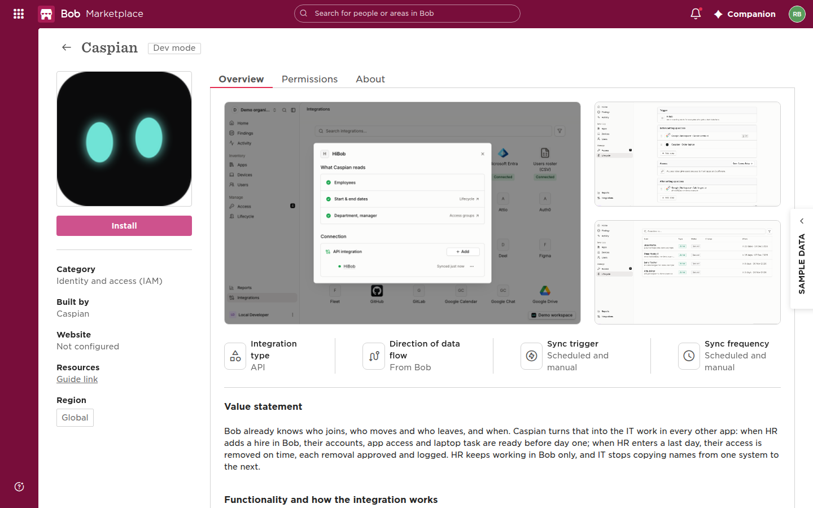
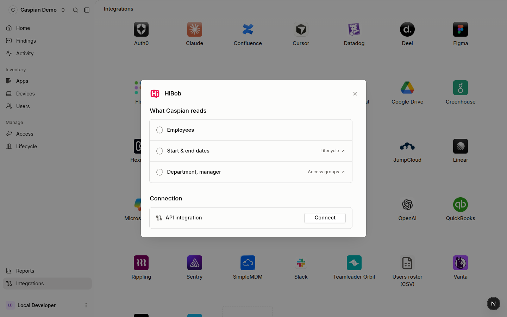
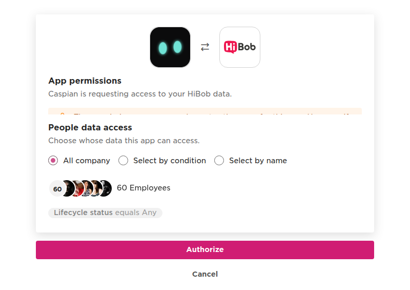
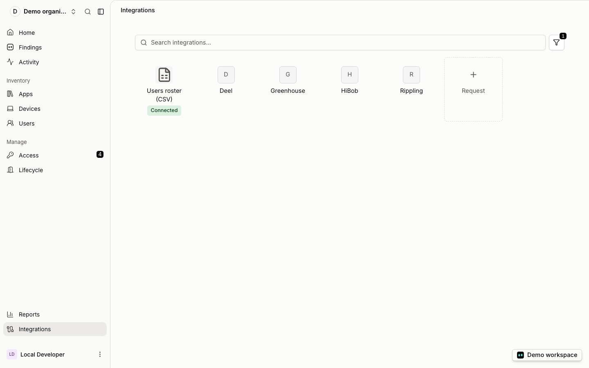
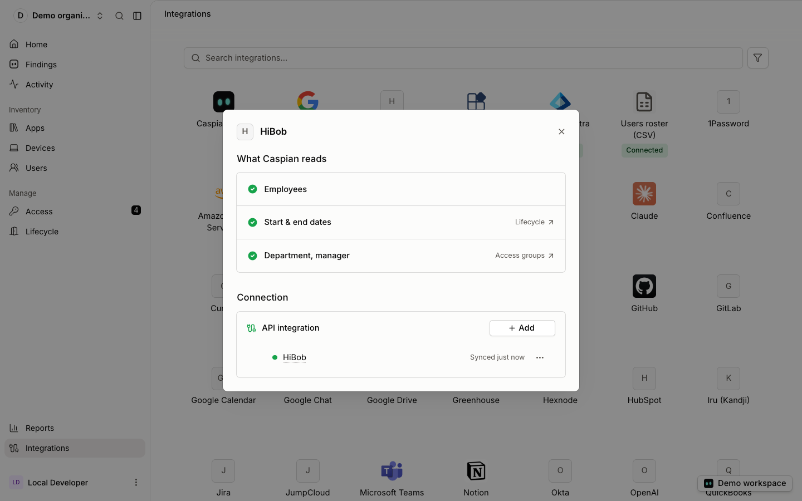
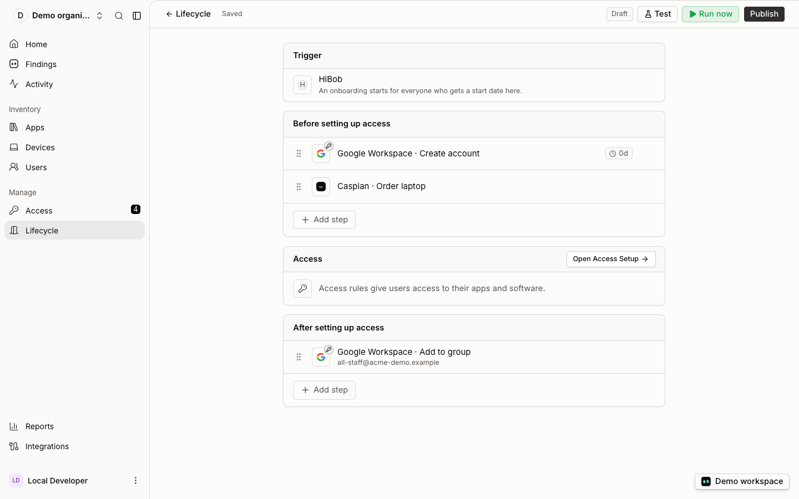
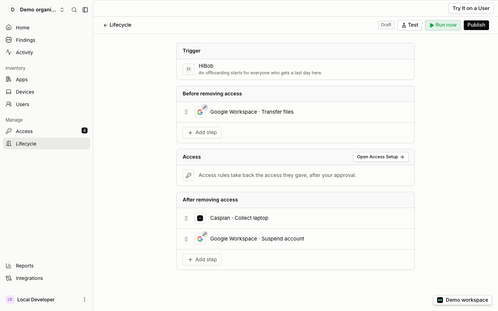
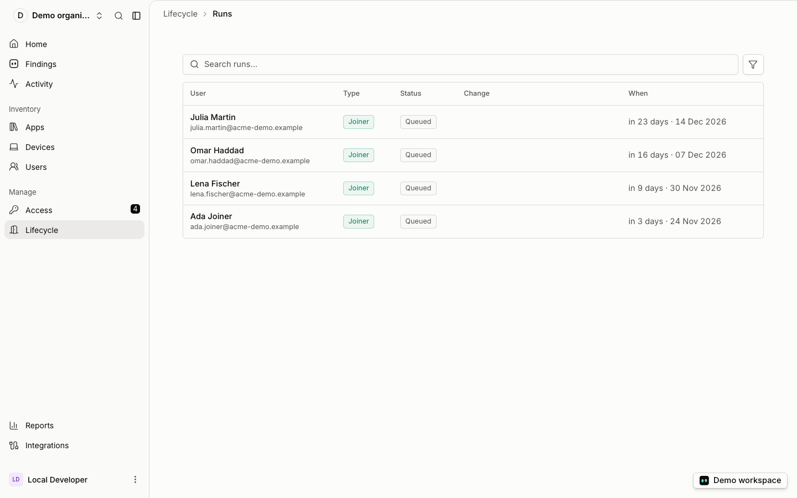

*Updated 22 November 2026.*

## Overview

Caspian is an IT platform. It connects to a company's identity provider, SaaS apps and laptops, and runs the IT side of joining, moving and leaving. The HiBob integration makes Bob the source for those events: when HR adds a hire in Bob, Caspian can set up their accounts, laptop and app access before their first day, and when HR enters a last day, Caspian can remove their access in the other apps on time.

The integration only reads from Bob. Caspian never changes anything in Bob.

## Before you start

- A Bob account with the rights to install apps from the Bob Marketplace (usually a Bob admin).
- A Caspian workspace at [app.getcaspian.io](https://app.getcaspian.io) and a Caspian admin login. A new workspace first connects its identity provider (Microsoft Entra ID, Google Workspace or Okta); that is the directory where Caspian creates and removes accounts. See [Connect your identity provider](/getting-started/connect-identity-provider).
- About five minutes.

## Install the app

You can start from either side. Both end on the same Bob consent screen, where you sign in to Bob; Caspian never asks for a Bob password or API token.

### From the Bob Marketplace

<Steps>
  <Step title="Find Caspian in Bob">
    In Bob, open the **Bob Marketplace**, search for **Caspian** and click **Install**.

    <Frame>
      
    </Frame>
  </Step>
  <Step title="Land on Caspian's HiBob page">
    Bob opens [app.getcaspian.io/integrations?integration=hibob](https://app.getcaspian.io/integrations?integration=hibob). Sign in to Caspian if asked, then click **Connect**.

    <Frame>
      
    </Frame>
  </Step>
  <Step title="Approve access in Bob">
    Bob shows its consent screen with the data Caspian asks to read. Under **People data access**, choose **All company**: Caspian needs every employee, including hires who have not started yet and people who left, to run onboarding and offboarding for them. Click **Authorize**.

    <Frame>
      
    </Frame>
  </Step>
  <Step title="Back in Caspian">
    Bob sends you back to Caspian, which shows HiBob as connected and reads Bob for the first time right away.
  </Step>
</Steps>

### From Caspian

<Steps>
  <Step title="Open HiBob in Caspian">
    Open [app.getcaspian.io/integrations?integration=hibob](https://app.getcaspian.io/integrations?integration=hibob), or in Caspian go to **Integrations** and click the **HiBob** tile (search for HiBob, or filter on HR).

    <Frame>
      
    </Frame>
  </Step>
  <Step title="Connect">
    Click **Connect**. Bob opens its consent screen; sign in to Bob if asked.
  </Step>
  <Step title="Approve access in Bob">
    Under **People data access**, choose **All company**, then click **Authorize**. Bob sends you back to Caspian, which shows HiBob as connected.
  </Step>
</Steps>

<Frame caption="HiBob connected in Caspian: what it reads and when it last synced">
  
</Frame>

## What Caspian reads, and how often

Caspian asks Bob for three read-only scopes: `employee_data:read`, `employee_data.history:read` and `company.metadata:read`. With them it reads, for each employee:

| Field in Bob | What Caspian uses it for |
| --- | --- |
| Name and work email | Who the person is, and how to match them to their accounts in the other apps |
| Department, job title and site | Which apps, groups and laptop a person gets; a department change starts a mover flow |
| Manager | Who gets the tasks and updates about a hire or leaver |
| Employment type | Rules that differ for employees and contractors |
| Start date | When onboarding runs, for example a week before day one |
| Lifecycle status, termination date and lifecycle history | Who joins, who leaves, and on which day |
| Department, title and site names | Bob stores these as list items; Caspian reads the lists to show "Engineering" rather than an id |

A personal email is read only for one person at a time, when a workflow step sends that person their first-day account details at home. Caspian does not keep it in its copy of the company's people.

Caspian does not ask for pay, bank details, address, date of birth, time off or documents.

**How often:** Caspian reads Bob every 6 hours. On a workflow with a HiBob trigger, **Check now** reads Bob right away, so a hire who was just added starts their run without waiting.

Caspian stores what it reads in the EU (AWS, Frankfurt). The [Trust Center](https://trust.getcaspian.io) and the [DPA](https://getcaspian.io/dpa) describe how it is processed.

## Set up workflows in Caspian

Connecting HiBob does not change anything on its own. You decide what happens when someone joins, moves or leaves, in Caspian's **Lifecycle** workflows.

1. In Caspian, open **Lifecycle** and open the onboarding workflow (or the offboarding one for leavers).
2. Under **Trigger**, choose **HiBob**:
   - **New hire**: starts as soon as the hire is added in Bob, or a number of days before their start date.
   - **Employee leaves**: starts as soon as the termination is in Bob, or a number of days before or after their last day.
   - **Department changes**: starts when someone moves to another department, or to one department you name.
3. Add the steps, for example: create the person's account in the identity provider, order their laptop and add them to the right groups; the **Access** rules give them their apps. For a leaver: transfer their files, collect the laptop and suspend or remove their accounts.
4. Click **Publish**. Each hire, leaver or move then starts its own run, which you follow under **Lifecycle › Runs**.

<Frame caption="An onboarding workflow that starts on a HiBob start date">
  
</Frame>

<Frame caption="An offboarding workflow that starts when an employee leaves in HiBob">
  
</Frame>

## How the data flows

Data goes one way: from Bob to Caspian. Caspian then acts in the identity provider and the other apps, never in Bob.

### Joiner

1. HR adds the hire in Bob with a start date.
2. On its next read (every 6 hours, or **Check now**), Caspian sees the new person, before their first day.
3. The person appears under **Lifecycle › Runs** as an upcoming joiner, and every workflow with the **New hire** trigger starts a run for them at the moment you chose.
4. The run creates their accounts, adds their app access and creates the laptop task, so everything is ready on day one.

<Frame caption="Upcoming joiners from HiBob under Lifecycle › Runs, each queued for their start date">
  
</Frame>

### Mover

1. HR changes the person's department in Bob.
2. On its next read, Caspian sees the change and keeps the previous department.
3. Every workflow with the **Department changes** trigger starts a run, for example to move the person into the new team's groups and apps.

Job title, site and manager changes update the person in Caspian; only a department change starts a **Department changes** run.

### Leaver

1. HR enters the termination and the last day in Bob.
2. On its next read, Caspian sees the termination date, also when the last day is still weeks away.
3. Every workflow with the **Employee leaves** trigger starts a run at the moment you chose: before, on or after the last day.
4. The run removes the person's access in the other apps. Caspian asks a person to approve each removal before it makes it, and logs it.

## Uninstall

1. In Bob, open the **Bob Marketplace**, then **Manage apps**.
2. Under **Installed apps**, find **Caspian** and click **Uninstall**.

Caspian can no longer read Bob from that moment. On its next read it shows HiBob as disconnected, and workflows with a HiBob trigger stop starting runs. Accounts and runs that already exist in Caspian stay as they are. To delete the people data Caspian read from Bob, write to [support@getcaspian.io](mailto:support@getcaspian.io).

## Troubleshooting

<AccordionGroup>
  <Accordion title="Hires who have not started yet, or people who left, are missing">
    The **People data access** choice at install was not **All company**. Uninstall the app in Bob and install it again, choosing **All company**.
  </Accordion>
  <Accordion title="A hire who was just added does not show">
    Caspian reads Bob every 6 hours. Open a workflow with a HiBob trigger and click **Check now**.
  </Accordion>
  <Accordion title="A leaver's run did not start">
    The run starts from the termination in Bob. Check that the termination and the last day are entered on the person in Bob, then click **Check now**.
  </Accordion>
  <Accordion title="A department change did not start a run">
    Only a change of department starts the **Department changes** trigger. A workflow set to one department starts only for moves into that department.
  </Accordion>
  <Accordion title="HiBob shows as disconnected">
    The app was uninstalled in Bob, or Bob no longer accepts Caspian's access. Connect again from [Integrations › HiBob](https://app.getcaspian.io/integrations?integration=hibob).
  </Accordion>
  <Accordion title="Connect fails after HiBob was disconnected">
    Disconnecting HiBob in Caspian leaves the app installed in Bob, so to connect again, first uninstall Caspian in Bob › **Marketplace** › **Manage apps**.
  </Accordion>
  <Accordion title="Someone shows twice, or is not matched to their accounts">
    Caspian matches people on their work email. Check that the work email in Bob is the one in the identity provider.
  </Accordion>
</AccordionGroup>

## Support

Write to [support@getcaspian.io](mailto:support@getcaspian.io). Caspian answers on working days, from Belgium. For HiBob's side, see the [Bob help center](https://help.hibob.com/).
